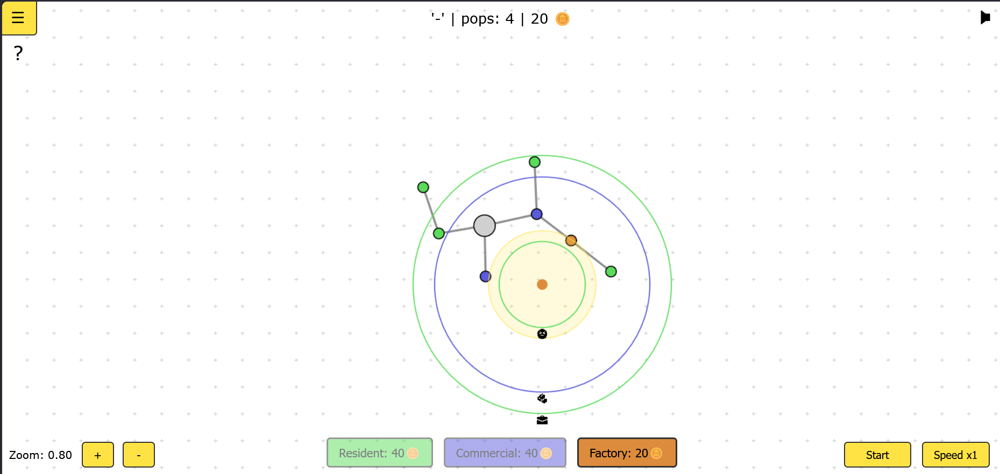
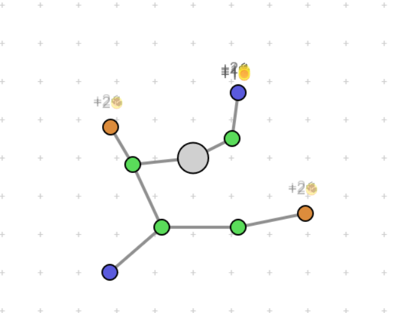
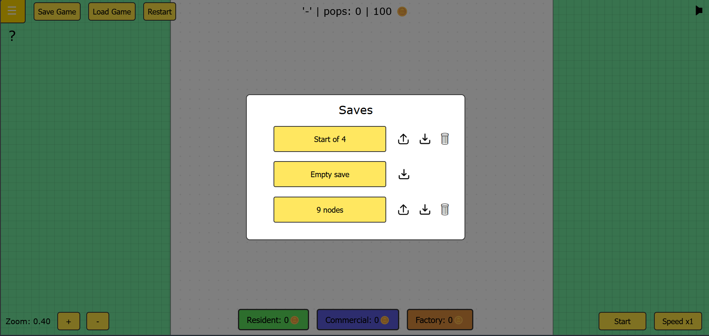
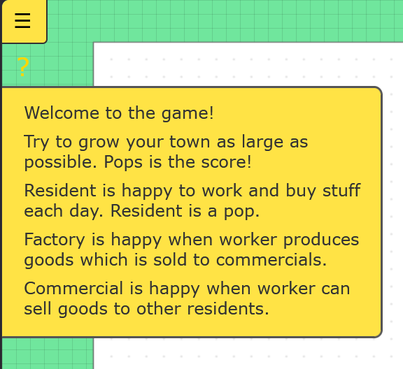

# Coin Town

**[Play Coin Town](https://kaj-sytnyart-36dd05.pages.fel.cvut.cz/)** · [Browse screenshots](docs/screenshots)



Coin Town is a small browser-based city-building simulation. The player places residents, commercial buildings, and factories on a pannable, zoomable canvas, then runs the simulation and tries to grow the population by keeping the local economy working.

I built it as a solo university project for the KAJ course at CTU FEL. It is intentionally a compact educational prototype: plain JavaScript modules, browser APIs, and Canvas rendering, with no framework, backend, database, or build step.

## How the simulation works

- **Residents** look for nearby work, receive wages, and shop for products. Their happiness falls when they cannot meet those needs.
- **Factories** employ residents, produce goods, and deliver them to commercial buildings within range.
- **Commercial buildings** employ residents, buy factory goods, and sell them to shoppers.
- Buildings connect automatically with roads. Placement must stay inside the town and near the existing network.
- Building costs rise as the town expands. Population is the score, while the town receives periodic coin income.
- Unsustainable residents or workplaces lose happiness and can disappear from the town.

## Features

- Canvas rendering with smooth `requestAnimationFrame` updates.
- Mouse-driven placement preview with valid-placement and interaction-range indicators.
- Canvas panning and button/wheel zoom controls.
- Start/pause control, Space shortcut, and ×1/×2/×4 simulation speeds.
- Animated feedback for wages, products, shopping, and happiness changes.
- Three named save slots stored in browser `localStorage`.
- JSON save import/export with file-type, structure, and size checks.
- Help, restart, background-audio, confirmation, and notification UI.
- Online/offline indicator; random town-name generation is disabled while offline.
- Responsive static deployment through GitLab Pages.

## Architecture

| Area | Responsibility |
|---|---|
| `ControllerManager` | Coordinates gameplay, UI, and saves |
| `Game` / `GameState` | Runs simulation timing and owns economic state |
| `GameNode` classes | Implements resident, shop, factory, and workplace behavior |
| `Screen` / `Connection` | Draws the canvas, roads, ranges, and animations |
| `UIController` | Connects DOM controls, dialogs, online state, and keyboard input |
| `SaveController` / `SaveManager` | Manages slots, `localStorage`, and JSON import/export |

The game deliberately separates simulation updates from canvas rendering: economic steps run on a fixed interval, while visible drawing continues through animation frames.

## Technology

- HTML5 and CSS
- JavaScript ES modules
- Canvas API
- jQuery for DOM event handling
- LocalStorage, FileReader, Fetch, and Web Audio APIs
- GitLab CI/Pages for static deployment

## Run locally

Because the application uses JavaScript modules, serve the repository through a small static server:

```bash
python -m http.server 8000
```

Then open `http://localhost:8000/`.

No dependency installation or compilation is required.

## Screenshots

### Economy simulation



### Save slots and portable saves



### In-game explanation



Additional screenshots show [canvas pan and zoom](docs/screenshots/canvas-pan-and-zoom.png) and the [new-town naming dialog](docs/screenshots/new-town-save-name-dialog.png).

## Project history

- **Active development:** 25 February–16 March 2025
- **Live-deployment link recorded:** 7 May 2025
- **Portfolio documentation pass:** August 2026, expanded November 2026
- **Git history:** 66 commits, all under my two Git identities

## Limitations

- Saves are browser-local unless manually exported; there are no accounts or cloud synchronization.
- The economy is intentionally small and lightly balanced.
- The interface is primarily designed for desktop mouse input.
- There is no automated test suite or package-based build pipeline.
- Random name generation depends on an external API.
- The repository currently has no software or asset license. Public visibility does not grant reuse rights; the audio/image origins should be reviewed before adding a license.
